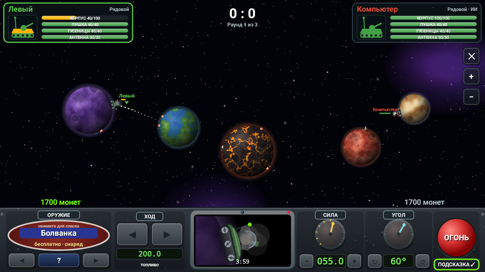
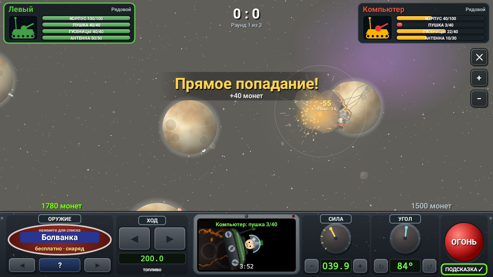
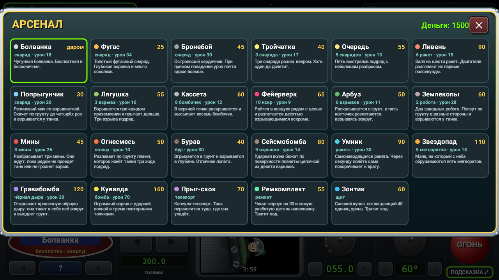
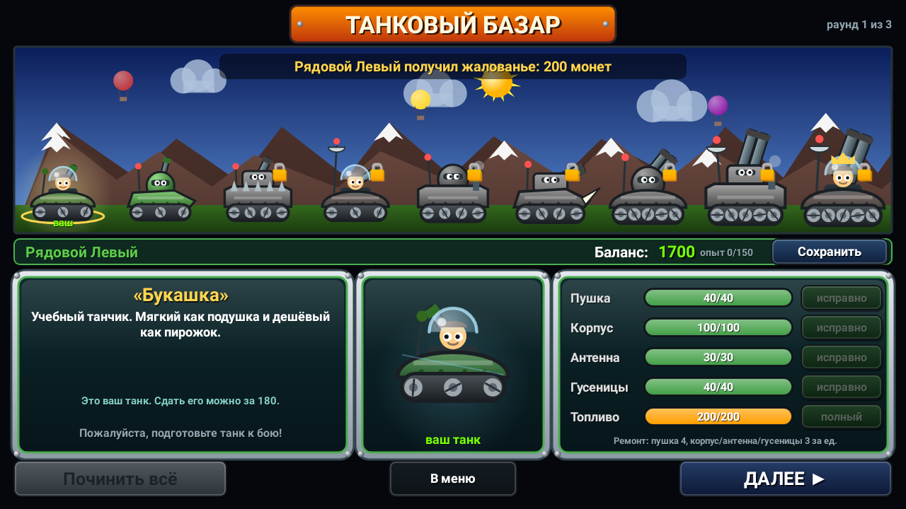

# TankiStador

Пошаговая артиллерийская дуэль танков на крошечных планетах для Android. Это фанатская игра по мотивам старой PC-игры: механика повторена по видео, а графика, звуки и тексты сделаны заново. Всё рисуется кодом, ассеты оригинала не используются.





## Установка

Готовый файл лежит в репозитории: [`apk/TankiStador.apk`](apk/TankiStador.apk). Скачайте его на телефон и откройте. Android попросит разрешить установку из неизвестного источника, это нормально для игр не из Google Play. Нужен Android 5.0 или новее.

Каждый push собирает свежий APK в GitHub Actions (вкладка **Actions** → **Build APK** → артефакт `TankiStador-apk`).

## Как играть

Два танка стоят на разных планетах и стреляют по очереди. Каждая планета притягивает снаряд, поэтому траектории изгибаются, и снаряд может облететь планету по дуге. Раунд выигрывает тот, кто первым разобьёт корпус противника. Матч длится 3, 5, 7 или 10 раундов.

**Пульт управления внизу экрана:**

| Блок | Что делает |
|---|---|
| ОРУЖИЕ | ◀ ▶ листают оружие, нажатие на табло открывает список, «?» показывает описание на мониторе |
| ХОД | удерживайте ◀ или ▶, чтобы ехать по планете; тратит топливо |
| Монитор | камера следит за снарядом, в паузах показывает ваш танк; внизу таймер хода (по умолчанию 4 минуты, меняется в настройках) |
| СИЛА / УГОЛ | крутите ручки пальцем или жмите «−», «+», «↻», «↺» |
| ОГОНЬ | выстрел; дорогое оружие оплачивается из ваших монет |
| ПОДСКАЗКА | пунктир начала траектории; длина зависит от антенны |

Угол можно задать и пальцем прямо на поле: ствол повернётся в сторону касания. Двумя пальцами поле масштабируется и сдвигается. Кнопки «+» и «−» справа делают то же самое.

**Повреждения.** У танка четыре узла, у каждого своя полоса прочности: корпус, пушка, гусеницы, антенна. Больше всего урона получает узел, ближайший к взрыву. Корпус всегда получает свою долю, и когда он разбит, танк уничтожен.
- Сломанная пушка стреляет совсем слабо и с большим разбросом.
- Без гусениц танк не может ехать, а изношенные гусеницы тратят больше топлива.
- Без антенны нет подсказки траектории, а монитор показывает только помехи.

«Ремкомплект» чинит корпус и самую разбитую деталь. Полный ремонт делается на базаре между раундами.

**Физика.** Воронки получаются неровными, вокруг них вздымается вал, края какое-то время светятся, по коре идут трещины. Разрушенная планета теряет массу и притягивает слабее. Сильный взрыв может сорвать танк с грунта и забросить на другую планету или в космос. Танк съезжает по крутым стенкам кратера. Обломки скал разлетаются, падают и отскакивают. В некоторых раундах по полю дрейфуют астероиды, их можно разбить.

**Деньги и звания.** Монеты дают за урон, прямые попадания, уничтожение врага и победу в раунде. Перед каждым раундом платят жалованье, и чем выше звание, тем оно больше. Если задеть поселенцев или их домики, будет штраф. Опыт повышает звание от рядового до генерала, а дорогие танки продаются только со звания.

**Танковый базар** открывается между раундами. Там можно купить один из 9 танков (старый танк засчитают в цену), починить детали и заправиться. Игра сохраняется кнопкой «Сохранить» и автоматически. Продолжить можно через «Загрузить игру».

### Оружие

| Название | Цена | Что делает |
|---|---|---|
| Болванка | 0 | обычный снаряд |
| Фугас | 25 | большой взрыв и глубокая воронка |
| Бронебой | 45 | при прямом попадании урон почти вдвое больше |
| Тройчатка | 40 | три снаряда веером |
| Очередь | 55 | пять выстрелов подряд |
| Ливень | 90 | залп из 6 ракет с двигателями |
| Попрыгунчик | 30 | отскакивает до 4 раз |
| Лягушка | 55 | три прыжка и три взрыва |
| Кассета | 60 | в верхней точке высыпает 8 бомбочек |
| Фейерверк | 65 | рвётся у цели на 10 взрывающихся искр |
| Арбуз | 50 | раскалывается, и косточки взрываются вокруг |
| Землекопы | 60 | два робота ползут по грунту к танкам |
| Мины | 45 | три мины ждут, пока рядом проедет танк или грохнет взрыв |
| Огнесмесь | 50 | пламя жжёт танки три хода |
| Бурав | 40 | взрывается в глубине грунта |
| Сейсмобомба | 80 | цепочка из 9 взрывов по поверхности |
| Умник | 90 | самонаводящаяся ракета |
| Звездопад | 110 | маяк, на который падают 5 метеоритов |
| Гравибомба | 120 | чёрная дыра тянет всё к себе и выедает грунт |
| Кувалда | 160 | огромный взрыв с ударной волной и тремя толчками |
| Прыг-скок | 70 | телепорт танка к месту падения |
| Ремкомплект | 55 | ремонт корпуса и самой разбитой детали |
| Зонтик | 60 | щит на 40 единиц урона |

Против компьютера можно играть на уровнях «новичок», «норма» и «ас». Можно играть и вдвоём на одном телефоне: справа выберите «Человек».





## Сборка

Нужны JDK 17+ и Android SDK (platform 35).

```bash
./gradlew assembleRelease        # app/build/outputs/apk/release/app-release.apk
./gradlew testDebugUnitTest      # логика, бой ИИ против ИИ и скриншоты всех экранов в screenshots-out/
```

Код на Kotlin, без сторонних библиотек: один `View` с собственным игровым циклом и рисованием на `Canvas`.

| Файл | Содержимое |
|---|---|
| `World.kt` | физика: гравитация, разрушаемые планеты, снаряды, урон |
| `Ai.kt` | компьютер, который подбирает выстрел пробными полётами |
| `BattleScene.kt` | ход боя и пульт |
| `ShopScene.kt` | танковый базар |
| `MenuScene.kt`, `NewGameScene.kt`, `MiscScenes.kt` | меню, рекорды, настройки |
| `TankArt.kt`, `WorldRenderer.kt`, `Gfx.kt` | процедурная графика |
| `Sound.kt` | синтезированные звуки |
